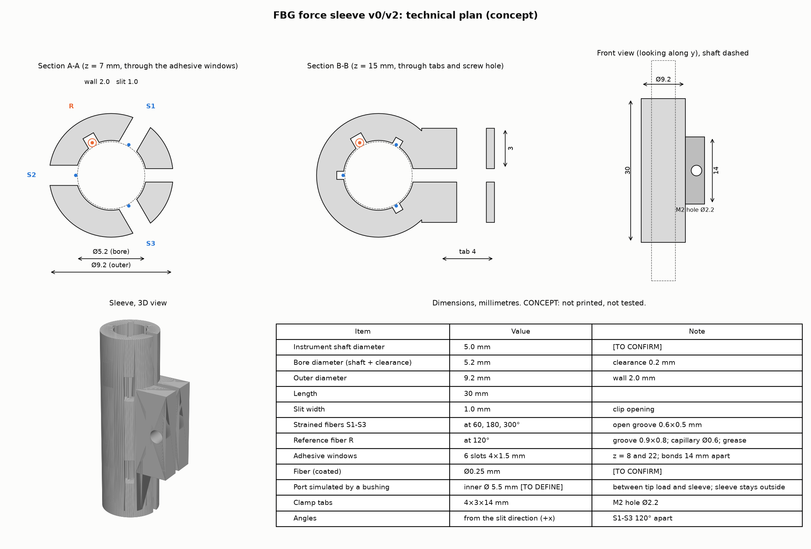
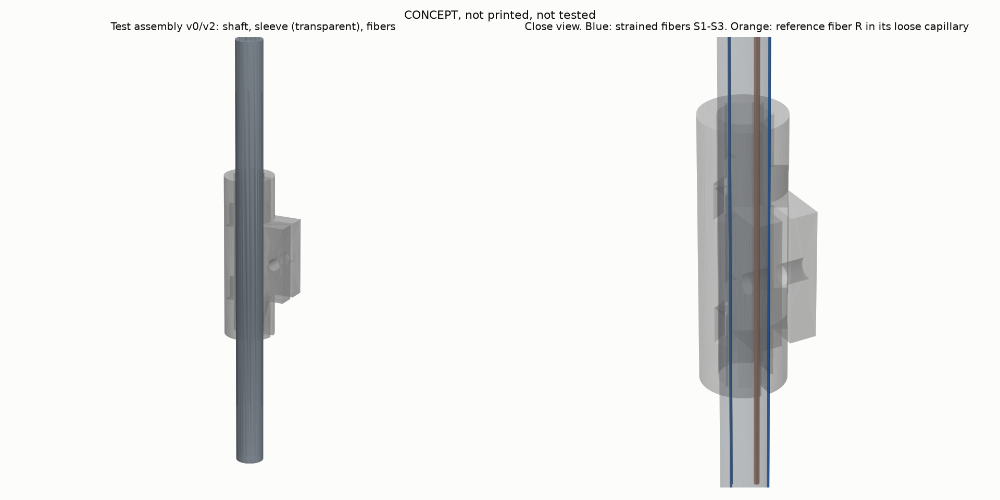

# Plan technique 3D du manchon (concept)

> **Concept, non imprimé, non essayé sur un instrument.** Toutes les dimensions sont des valeurs par défaut à confirmer. Usage de recherche uniquement.
> *English summary: a 3D concept of a 30 mm clip-on sleeve for a 5 mm shaft (9.2 mm outside diameter, 13.2 mm with the clamp tabs), with three open grooves and six adhesive windows for the strained fibers, one open groove for the strain-free reference fiber in a loose capillary with thermal grease, and a split clamp with an M2 screw. The three earlier open points now have a design answer, none validated by a test. The model passes geometry checks. It has not been printed, assembled or tested, and it does not amplify strain (no flexure). The sleeve stays outside the port, so the tip force still needs a fulcrum model.*





## 1. Fichiers

| Fichier | Contenu | État |
|---|---|---|
| `hardware/generate_sleeve.py` | Génère le modèle 3D, les STL, les plans et un contrôle géométrique | Exécuté |
| `hardware/sleeve_v0.stl` | Manchon seul | Généré, vérifié (voir §5), non imprimé |
| `hardware/test_assembly_v0.stl` | Manchon, tige de test et fibres (une seule pièce fusionnée, pour la visualisation) | Généré, non destiné à l'impression |
| `hardware/sleeve_model_check.json` | Résultat du contrôle géométrique | Généré |
| `hardware/sleeve.scad` | Même géométrie en OpenSCAD | **Non rendu** (OpenSCAD absent) |
| `docs/plan_technique_sleeve.png` | Coupes A-A et B-B, vue de face, vue 3D, tableau de cotes | Généré |
| `docs/assembly_3d.png` | Tige, manchon (transparent) et fibres | Généré |

## 2. Dimensions par défaut (millimètres)

| Élément | Valeur | Remarque |
|---|---|---|
| Diamètre de la tige d'instrument | 5,0 | **[À CONFIRMER]**. Les instruments manuels courants font 5 ou 10 mm (ports de 5, 10 et 12 mm). Le 8 mm utilisé auparavant n'est pas une taille manuelle courante |
| Alésage du manchon | 5,2 | tige + jeu de 0,2 |
| Diamètre extérieur | 9,2 | paroi de 2,0. 13,2 de large avec les pattes |
| Longueur | 30 | |
| Fente de serrage | 1,0 | ouverte vers +x |
| Fibres sous contrainte S1 à S3 | à 60°, 180°, 300° | espacées de 120°, angles mesurés depuis la direction de la fente |
| Rainure des fibres S1 à S3 | 0,6 × 0,5 | ouverte vers la tige, pour le collage |
| Fenêtres de collage | 6 fentes de 4 × 1,5 | à z = 8 et 22 mm, au-dessus de chaque rainure S |
| Fibre de référence R | à 120° | rainure ouverte de 0,9 × 0,8, capillaire souple de Ø0,6 **[À CONFIRMER]**, graisse thermique |
| Fibre enrobée | Ø0,25 | revêtement usuel de 245 µm (250 µm pour les fibres colorées) : **[À CONFIRMER]** selon la fibre achetée |
| Pattes de serrage | 4 × 3 × 14 | trou de Ø2,2 pour une vis M2 (série fine de la norme ISO 273, **non vérifié** : la norme est payante) |
| Port simulé pour l'essai de port | bague de Ø intérieur 5,5 **[À DÉFINIR]** | entre la charge et le manchon, qui reste à l'extérieur |

## 3. Assemblage prévu (concept)

1. Poser la fibre de référence R dans son capillaire souple, enduire de graisse thermique, et la placer dans sa rainure sur la tige, sans la coller.
2. Poser les fibres S1 à S3 dans leurs rainures, en contact avec la tige.
3. Glisser le manchon ouvert sur la tige à la position voulue et serrer la vis M2 sur les pattes.
4. Déposer la colle sur chaque fibre S1 à S3 par les deux fenêtres de sa rainure (deux points de collage espacés de 14 mm), puis la faire durcir. Type de colle et durcissement : [À DÉFINIR].
5. Raccorder les fibres à l'interrogateur.

## 4. Choix de conception et raisons

- **Rainures ouvertes pour S1 à S3 :** les fibres doivent être liées à la tige pour en suivre la déformation. Le manchon les tient et les protège, il ne transmet pas la contrainte.
- **Fenêtres de collage :** six fenêtres de 4 × 1,5 mm (deux par rainure, à z = 8 et 22 mm) donnent accès à la fibre pour déposer la colle en deux points.
- **Fibre de référence R dans une rainure ouverte, en capillaire souple et graisse thermique :** elle reste libre de contrainte, car elle n'est pas collée, et elle touche la tige, ce qui doit la garder à la température de la tige.
- **Disposition à 120° :** celle de la simulation.
- **Fente et pattes :** pose et dépose sans démonter l'instrument.
- **Tige de 5 mm :** taille manuelle courante. À flexion égale, elle est 2 à 3 fois plus sensible qu'une tige de 8 mm (théorie des poutres).

## 5. Contrôles faits sur le modèle

Par `generate_sleeve.py` : maillage étanche, une seule pièce, volume 1 542,5 mm³, aucun recouvrement entre le manchon et les fibres, le capillaire ou la tige, paroi minimale de 1,5 mm sous les rainures des fibres S et de 1,2 mm sous celle de la référence, six fenêtres de collage, points de collage espacés de 14 mm, diamètre extérieur de 9,2 mm et largeur de 13,2 mm avec les pattes. Ces contrôles portent sur la géométrie. Ils ne disent rien de l'impression, de la résistance des parois découpées par les fenêtres, du comportement mécanique ou de la mesure.

## 6. Limites et points non résolus

Les trois points ouverts du premier plan ont reçu une réponse de conception. **Aucune n'est validée par un essai.**

- **Couplage thermique de R : traité dans la conception, à mesurer.** La fibre de référence est en contact avec la tige (capillaire souple et graisse thermique). Rien ne prouve encore qu'elle suive la température de la tige. L'essai de décalage du réseau de référence doit le mesurer en premier. Dans la simulation actuelle (réseaux collés à 30 pm/°C, référence libre à 11,5 pm/°C), un décalage de 1 °C du réseau de référence ajoute **34 N** d'erreur axiale sur la tige de 5 mm (60 N sur le tube de 8 mm). Les propriétés de la graisse et du capillaire ne sont pas choisies.
- **Collage : traité.** Six fenêtres donnent accès à chaque fibre en deux points espacés de 14 mm. Le type de colle, son durcissement, la longueur de la zone du réseau entre les deux points et la précontrainte restent à définir.
- **Passage dans le trocart : résolu pour le montage, ouvert pour l'interprétation.** Le manchon (Ø9,2, 13,2 de large avec les pattes) ne passe pas dans un port prévu pour une tige de 5 mm, et une paroi plus fine n'y change rien : les rainures et la paroi imprimable imposent un diamètre extérieur supérieur. Le manchon reste **à l'extérieur du port, côté poignée**. Sur banc, l'essai de port simule le port par une bague d'alésage proche de celui de la tige (Ø5,5 par défaut, **[À DÉFINIR]**), placée entre le point de charge et le manchon. **Reste ouvert :** côté poignée, la déformation dépend de la réaction du port et de la force de la main, pas seulement de la force de pointe. Retrouver la force de pointe demande un modèle du point d'appui (des brevets d'estimation à partir d'un capteur proximal le décrivent) ou un capteur intégré à la tige. Une variante sans pattes pourrait passer un port de 10 ou 12 mm : non étudiée.
- **Matériau et impression :** non choisis. Le PLA ramollit entre 55 et 65 °C et sa température de fléchissement sous charge est d'environ 53 °C. Il convient pour des essais à faible élévation de température. Près de la zone chaude d'un instrument (tige à plus de 120 °C sur environ 10 mm de longueur près de la pointe d'un crochet monopolaire de 5 mm, d'après une étude de 2021), il faut un matériau à plus haute température. Aucune stérilisation revendiquée.
- **Zone du réseau :** la position et la longueur des réseaux de Bragg ne sont pas fixées.
- **Sensibilité thermique des réseaux collés :** estimée à environ 30 pm/°C d'après la dilatation de l'acier (aucune mesure trouvée). C'est la valeur qui fait de l'écart thermique le risque principal.

## 7. Régénérer

```bash
pip install -r hardware/requirements-hardware.txt
python hardware/generate_sleeve.py
```
